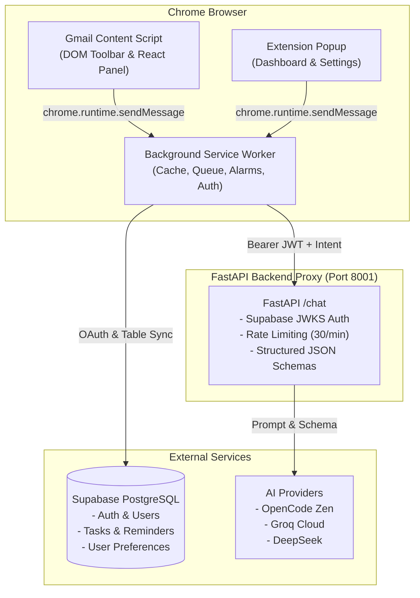

# MailX - Codebase Architecture & File Reference

This document provides a comprehensive explanation of every module, directory, and file across the **MailX** codebase.

---

## 📑 Table of Contents
1. [High-Level Architecture & Workflow](#1-high-level-architecture--workflow)
2. [Root Directory Files](#2-root-directory-files)
3. [Backend Module (`/backend`)](#3-backend-module-backend)
4. [Chrome Extension (`/extension`)](#4-chrome-extension-extension)
   - [4.1 Manifest & Build Config](#41-manifest--build-config)
   - [4.2 Background Service Worker (`/src/background`)](#42-background-service-worker-srcbackground)
   - [4.3 Gmail Content Script & DOM Injection (`/src/content`)](#43-gmail-content-script--dom-injection-srccontent)
   - [4.4 Popup Application (`/src/popup`)](#44-popup-application-srcpopup)
   - [4.5 UI Design System & Features (`/src/ui`)](#45-ui-design-system--features-srcui)
   - [4.6 Shared Utilities & Storage (`/src/shared`)](#46-shared-utilities--storage-srcshared)
   - [4.7 Tests & Scripts (`/tests`, `/scripts`)](#47-tests--scripts-tests-scripts)
5. [Database & Migrations (`/supabase`)](#5-database--migrations-supabase)
6. [Showcase & Landing Website (`/website`)](#6-showcase--landing-website-website)
7. [Project Documentation (`/documents`)](#7-project-documentation-documents)

---

## 1. High-Level Architecture & Workflow

MailX is structured into four core components:
1. **Chrome Extension (MV3)**: Integrates into Gmail via DOM observation, presents an in-page slide-out AI sidepanel, provides a popup dashboard, and coordinates background tasks.
2. **FastAPI Backend Proxy**: Thin, secure gateway that handles rate-limiting, JWT authentication verification (via Supabase JWKS), and schema-enforced prompt proxying to LLMs (OpenCode Zen, Groq Cloud, DeepSeek).
3. **Supabase Database**: PostgreSQL backend providing Google OAuth authentication, Row Level Security (RLS), user preferences, task tracking, and follow-up reminders.
4. **Marketing Website**: Showcase and distribution site built with React & Vite.

---

## 2. Root Directory Files

| File | Purpose & Description |
| :--- | :--- |
| [`README.md`](file:///c:/Users/Sadik/Documents/Google%20Antigravity/CSE412/README.md) | Primary project readme containing feature overview, quick-start instructions, architecture diagram, and developer guidelines. |
| [`AGENTS.md`](file:///c:/Users/Sadik/Documents/Google%20Antigravity/CSE412/AGENTS.md) | Developer and AI coding agent guidelines, detailing port allocations (Backend `8001`, Vite `5174`), environment variables, and testing instructions. |
| [`render.yaml`](file:///c:/Users/Sadik/Documents/Google%20Antigravity/CSE412/render.yaml) | Deployment configuration blueprint for hosting the FastAPI backend on Render. |
| [`.gitignore`](file:///c:/Users/Sadik/Documents/Google%20Antigravity/CSE412/.gitignore) | Specifies files and directories ignored by Git (e.g. `node_modules`, `.env`, `dist`, `__pycache__`). |

---

## 3. Backend Module (`/backend`)

The backend is built with FastAPI (Python 3.13) to serve as a secure gateway between the client extension and AI models.

| File | Purpose & Description |
| :--- | :--- |
| [`main.py`](file:///c:/Users/Sadik/Documents/Google%20Antigravity/CSE412/backend/main.py) | **Core FastAPI Application**:  • **Lifespan Management**: Manages HTTP connection pools (`httpx.AsyncClient`) and JWKS cache. • **Authentication**: Verifies Supabase Bearer JWTs using public JWKS (with development bypass when `MAILX_DEV_MODE=1`). • **Rate Limiting**: Sliding window rate limiting (30 requests/min per user). • **AI Intent Routing**: Handles intents (`summarize`, `reply`, `priority`, `tasks`, `draft`, `spam`, `phishing`, `chat`) and maps them to prompt templates. • **JSON Enforcement**: Uses Pydantic schemas to validate structured responses. • **Endpoints**: Exposes `POST /chat`, `GET /models/status`, and `GET /health`. |
| [`test_main.py`](file:///c:/Users/Sadik/Documents/Google%20Antigravity/CSE412/backend/test_main.py) | **Automated Backend Test Suite**: Comprehensive pytest suite testing JWT authentication, rate limiting, request validation, fallback providers, and error handling. |
| [`benchmark.py`](file:///c:/Users/Sadik/Documents/Google%20Antigravity/CSE412/backend/benchmark.py) | **Performance & Latency Benchmarks**: Standalone benchmarking tool to measure LLM response times, token counts, and efficiency. |
| [`requirements.txt`](file:///c:/Users/Sadik/Documents/Google%20Antigravity/CSE412/backend/requirements.txt) | **Python Dependencies**: Defines packages including `fastapi`, `uvicorn`, `httpx`, `python-dotenv`, `pydantic`, `pyjwt`, and `cryptography`. |
| [`Dockerfile`](file:///c:/Users/Sadik/Documents/Google%20Antigravity/CSE412/backend/Dockerfile) | Container image specification for running the backend in Docker/cloud environments. |
| [`.dockerignore`](file:///c:/Users/Sadik/Documents/Google%20Antigravity/CSE412/backend/.dockerignore) | Patterns excluded from the Docker build context. |
| [`.env.example`](file:///c:/Users/Sadik/Documents/Google%20Antigravity/CSE412/backend/.env.example) | Template of environment variables needed (`ZEN_API_KEY`, `GROQ_API_KEY`, `DEEPSEEK_API_KEY`, `SUPABASE_URL`, `MAILX_DEV_MODE`, etc.). |

---

## 4. Chrome Extension (`/extension`)

### 4.1 Manifest & Build Config
| File | Purpose & Description |
| :--- | :--- |
| [`manifest.json`](file:///c:/Users/Sadik/Documents/Google%20Antigravity/CSE412/extension/manifest.json) | **Extension Manifest (Manifest V3)**: Declares permissions (`storage`, `alarms`, `notifications`, `identity`, `clipboardWrite`), host permissions, background service worker, and content scripts for `mail.google.com`. |
| [`vite.config.ts`](file:///c:/Users/Sadik/Documents/Google%20Antigravity/CSE412/extension/vite.config.ts) | Vite build configuration leveraging `@crxjs/vite-plugin`. Hardcoded to port `5174` for live HMR. |
| [`package.json`](file:///c:/Users/Sadik/Documents/Google%20Antigravity/CSE412/extension/package.json) | NPM package definitions, scripts (`dev`, `build`, `test`), and dependencies (React 18, Supabase client, Lucide icons, Vitest). |
| [`tsconfig.json`](file:///c:/Users/Sadik/Documents/Google%20Antigravity/CSE412/extension/tsconfig.json) | TypeScript configuration for client modules. |
| [`vitest.config.ts`](file:///c:/Users/Sadik/Documents/Google%20Antigravity/CSE412/extension/vitest.config.ts) | Test runner configuration for Vitest. |

---

### 4.2 Background Service Worker (`/extension/src/background`)
The background worker coordinates storage, network requests, background jobs, and browser alarms.

| File | Purpose & Description |
| :--- | :--- |
| [`index.ts`](file:///c:/Users/Sadik/Documents/Google%20Antigravity/CSE412/extension/src/background/index.ts) | **Central Message Router**: Handles messages sent via `chrome.runtime.sendMessage` from content scripts or popup. Enforces explicit user consent policies, manages request tracing, and routes calls to API/database handlers. |
| [`api.ts`](file:///c:/Users/Sadik/Documents/Google%20Antigravity/CSE412/extension/src/background/api.ts) | **Backend HTTP Client**: Dispatches requests to the FastAPI `/chat` endpoint with deadline timeouts and error formatting. |
| [`supabase.ts`](file:///c:/Users/Sadik/Documents/Google%20Antigravity/CSE412/extension/src/background/supabase.ts) | **Supabase Client & Auth Manager**: Implements Google OAuth via `chrome.identity.launchWebAuthFlow`, local development authentication, session storage in `chrome.storage.local`, and CRUD operations for tasks, reminders, and preferences. |
| [`queue.ts`](file:///c:/Users/Sadik/Documents/Google%20Antigravity/CSE412/extension/src/background/queue.ts) | **Priority Request Queue**: Serializes and throttles AI requests across `foreground` (user-blocking actions) and `background` lanes to prevent UI freezes. |
| [`requestRegistry.ts`](file:///c:/Users/Sadik/Documents/Google%20Antigravity/CSE412/extension/src/background/requestRegistry.ts) | **Abort/Cancellation Registry**: Manages `AbortController` handles by `request_id`, allowing client UI to immediately cancel pending requests. |
| [`reminders.ts`](file:///c:/Users/Sadik/Documents/Google%20Antigravity/CSE412/extension/src/background/reminders.ts) | **Follow-up Reminders Engine**: Sets up periodic alarms with `chrome.alarms`, checks due reminders, and delivers desktop notifications via `chrome.notifications`. |
| [`stats.ts`](file:///c:/Users/Sadik/Documents/Google%20Antigravity/CSE412/extension/src/background/stats.ts) | **Mail Statistics Processor**: Calculates email volume, sent/received patterns, and top senders from Gmail threads. |
| [`gmail.ts`](file:///c:/Users/Sadik/Documents/Google%20Antigravity/CSE412/extension/src/background/gmail.ts) | **Gmail API Client**: Interfaces directly with Google's Gmail REST API using OAuth access tokens. |
| [`spam.ts`](file:///c:/Users/Sadik/Documents/Google%20Antigravity/CSE412/extension/src/background/spam.ts) | **Spam Evaluation**: Analyzes email headers, content patterns, and AI verdicts to detect spam. |
| [`phishing.ts`](file:///c:/Users/Sadik/Documents/Google%20Antigravity/CSE412/extension/src/background/phishing.ts) | **Phishing & URL Scanner**: Inspects email links for homograph attacks, suspicious TLDs, and known phishing patterns. |

---

### 4.3 Gmail Content Script & DOM Injection (`/extension/src/content`)
Injected into `mail.google.com` to observe Gmail's UI and render MailX elements.

| File | Purpose & Description |
| :--- | :--- |
| [`index.ts`](file:///c:/Users/Sadik/Documents/Google%20Antigravity/CSE412/extension/src/content/index.ts) | **Content Script Entry Point**:  • Injects MailX action buttons (Summarize, Reply, Tasks, Priority, Phishing, Spam) into the Gmail top action bar. • Listens for URL/navigation changes and thread selections. • Handles hotkeys, link hover inspections, and sidepanel opening/closing. |
| [`toolbarObserver.ts`](file:///c:/Users/Sadik/Documents/Google%20Antigravity/CSE412/extension/src/content/toolbarObserver.ts) | **DOM Observer**: Watches Gmail DOM mutations using `MutationObserver` to ensure action buttons persist during view changes. |
| [`toolbar.css`](file:///c:/Users/Sadik/Documents/Google%20Antigravity/CSE412/extension/src/content/toolbar.css) | Styles for injected toolbar buttons, icons, and action badges. |
| [`gmail/insertion.ts`](file:///c:/Users/Sadik/Documents/Google%20Antigravity/CSE412/extension/src/content/gmail/insertion.ts) | **Gmail DOM Insertion**: Finds active Gmail `contentEditable` compose boxes and inserts generated draft/reply text while triggering input events. |
| [`panel/mountPanel.tsx`](file:///c:/Users/Sadik/Documents/Google%20Antigravity/CSE412/extension/src/content/panel/mountPanel.tsx) | Renders and mounts the React `PanelApp` component into the Gmail page. |
| [`panel/PanelHost.ts`](file:///c:/Users/Sadik/Documents/Google%20Antigravity/CSE412/extension/src/content/panel/PanelHost.ts) | Manages the root DOM node and Shadow DOM encapsulation for the sidepanel. |
| [`panel/PanelController.ts`](file:///c:/Users/Sadik/Documents/Google%20Antigravity/CSE412/extension/src/content/panel/PanelController.ts) | Imperative bridge linking Gmail DOM events with the React sidepanel state. |
| [`panel/PanelApp.tsx`](file:///c:/Users/Sadik/Documents/Google%20Antigravity/CSE412/extension/src/content/panel/PanelApp.tsx) | **React Slide-out Sidepanel**: Main UI inside Gmail providing tabs for AI Summary, Smart Replies, Tasks, Draft Generator, Security Scan, and Chat. |
| [`panel/panel.css`](file:///c:/Users/Sadik/Documents/Google%20Antigravity/CSE412/extension/src/content/panel/panel.css) | Scoped CSS styles for the sidepanel layout, transitions, and cards. |

---

### 4.4 Popup Application (`/extension/src/popup`)
The standalone UI opened by clicking the extension icon in the Chrome toolbar.

| File | Purpose & Description |
| :--- | :--- |
| [`index.html`](file:///c:/Users/Sadik/Documents/Google%20Antigravity/CSE412/extension/src/popup/index.html) | HTML container for the popup window. |
| [`index.tsx`](file:///c:/Users/Sadik/Documents/Google%20Antigravity/CSE412/extension/src/popup/index.tsx) | React root mounting point for the popup. |
| [`App.tsx`](file:///c:/Users/Sadik/Documents/Google%20Antigravity/CSE412/extension/src/popup/App.tsx) | **Popup Root App**: Manages top-level navigation (Home, Tasks, Insights, Settings), authentication status, and theme setup. |
| [`popup.css`](file:///c:/Users/Sadik/Documents/Google%20Antigravity/CSE412/extension/src/popup/popup.css) | Sizing and layout styles for the popup container. |
| [`statsRequestGuard.ts`](file:///c:/Users/Sadik/Documents/Google%20Antigravity/CSE412/extension/src/popup/statsRequestGuard.ts) | Throttling guard to avoid redundant stats requests when rapidly reopening the popup. |
| [`views/HomeView.tsx`](file:///c:/Users/Sadik/Documents/Google%20Antigravity/CSE412/extension/src/popup/views/HomeView.tsx) | **Dashboard View**: Displays user account details, quick statistics, upcoming follow-up reminders, and pending tasks. |
| [`views/SettingsView.tsx`](file:///c:/Users/Sadik/Documents/Google%20Antigravity/CSE412/extension/src/popup/views/SettingsView.tsx) | Wrapper view rendering the settings form. |

---

### 4.5 UI Design System & Features (`/extension/src/ui`)

#### Design System Components (`/src/ui/components`)
- [`Button.tsx`](file:///c:/Users/Sadik/Documents/Google%20Antigravity/CSE412/extension/src/ui/components/Button.tsx) & `Button.css`: Accessible button supporting variants (`primary`, `secondary`, `ghost`, `danger`) and loading indicators.
- [`Dialog.tsx`](file:///c:/Users/Sadik/Documents/Google%20Antigravity/CSE412/extension/src/ui/components/Dialog.tsx) & `Dialog.css`: Modal overlay dialog and confirmation prompts.
- [`Feedback.tsx`](file:///c:/Users/Sadik/Documents/Google%20Antigravity/CSE412/extension/src/ui/components/Feedback.tsx) & `Feedback.css`: Alerts, badges, toast notifications, and empty state cards.
- [`Fields.tsx`](file:///c:/Users/Sadik/Documents/Google%20Antigravity/CSE412/extension/src/ui/components/Fields.tsx) & `Fields.css`: Input fields, text areas, checkboxes, and select dropdowns.
- [`Layout.tsx`](file:///c:/Users/Sadik/Documents/Google%20Antigravity/CSE412/extension/src/ui/components/Layout.tsx) & `Layout.css`: Structural layout containers (Stack, Box, Card, Flex).
- [`SegmentedControl.tsx`](file:///c:/Users/Sadik/Documents/Google%20Antigravity/CSE412/extension/src/ui/components/SegmentedControl.tsx) & `SegmentedControl.css`: Pill toggle switch.
- [`Tabs.tsx`](file:///c:/Users/Sadik/Documents/Google%20Antigravity/CSE412/extension/src/ui/components/Tabs.tsx) & `Tabs.css`: Tab bar navigation components.

#### Feature Views (`/src/ui/features`)
- **Assistant (`/features/assistant`)**:
  - [`AssistantView.tsx`](file:///c:/Users/Sadik/Documents/Google%20Antigravity/CSE412/extension/src/ui/features/assistant/AssistantView.tsx): Unified view coordinating email summarization, action points, and quick reply triggers.
  - [`ChatView.tsx`](file:///c:/Users/Sadik/Documents/Google%20Antigravity/CSE412/extension/src/ui/features/assistant/ChatView.tsx): Conversational chat interface allowing interactive questions about the email thread.
  - [`DraftView.tsx`](file:///c:/Users/Sadik/Documents/Google%20Antigravity/CSE412/extension/src/ui/features/assistant/DraftView.tsx): AI Draft Generator with configurable tone, length, and goals.
  - [`ResultView.tsx`](file:///c:/Users/Sadik/Documents/Google%20Antigravity/CSE412/extension/src/ui/features/assistant/ResultView.tsx): Structured display cards for key points, extracted deadlines, and smart replies.
  - [`SecurityResultView.tsx`](file:///c:/Users/Sadik/Documents/Google%20Antigravity/CSE412/extension/src/ui/features/assistant/SecurityResultView.tsx): Visual display for spam and phishing security check results.
  - [`conversation.ts`](file:///c:/Users/Sadik/Documents/Google%20Antigravity/CSE412/extension/src/ui/features/assistant/conversation.ts) & [`response.ts`](file:///c:/Users/Sadik/Documents/Google%20Antigravity/CSE412/extension/src/ui/features/assistant/response.ts): Chat history pruning and AI response parsing utilities.
- **Auth (`/features/auth`)**:
  - [`AuthView.tsx`](file:///c:/Users/Sadik/Documents/Google%20Antigravity/CSE412/extension/src/ui/features/auth/AuthView.tsx): Google OAuth login interface and dev login options.
  - [`AccountSummary.tsx`](file:///c:/Users/Sadik/Documents/Google%20Antigravity/CSE412/extension/src/ui/features/auth/AccountSummary.tsx): Profile header showing user email, avatar, and sign-out button.
- **Tasks (`/features/tasks`)**:
  - [`TasksView.tsx`](file:///c:/Users/Sadik/Documents/Google%20Antigravity/CSE412/extension/src/ui/features/tasks/TasksView.tsx): Task manager UI allowing users to view, complete, delete, and filter email tasks.
  - [`useTasks.ts`](file:///c:/Users/Sadik/Documents/Google%20Antigravity/CSE412/extension/src/ui/features/tasks/useTasks.ts): React hook managing task state and syncing with Supabase/cache.
- **Insights (`/features/insights`)**:
  - [`InsightsView.tsx`](file:///c:/Users/Sadik/Documents/Google%20Antigravity/CSE412/extension/src/ui/features/insights/InsightsView.tsx): Analytics charts showing email activity and response rates.
  - [`useInsights.ts`](file:///c:/Users/Sadik/Documents/Google%20Antigravity/CSE412/extension/src/ui/features/insights/useInsights.ts): Hook fetching and formatting email statistics.
- **Settings (`/features/settings`)**:
  - [`SettingsForm.tsx`](file:///c:/Users/Sadik/Documents/Google%20Antigravity/CSE412/extension/src/ui/features/settings/SettingsForm.tsx): Preferences editor for AI tone, default summary length, model selection, and auto-save options.

#### Styles & Runtime (`/src/ui/styles`, `/src/ui/runtime`)
- [`tokens.css`](file:///c:/Users/Sadik/Documents/Google%20Antigravity/CSE412/extension/src/ui/styles/tokens.css): Design tokens (colors, typography, spacing, border radii, shadows).
- [`base.css`](file:///c:/Users/Sadik/Documents/Google%20Antigravity/CSE412/extension/src/ui/styles/base.css) & `components.css`: Global base styles and utility classes.
- [`theme.ts`](file:///c:/Users/Sadik/Documents/Google%20Antigravity/CSE412/extension/src/ui/runtime/theme.ts): Dark/light mode theme management.
- [`sendMessage.ts`](file:///c:/Users/Sadik/Documents/Google%20Antigravity/CSE412/extension/src/ui/runtime/sendMessage.ts): Type-safe wrapper for Chrome runtime messaging.
- [`icons/index.ts`](file:///c:/Users/Sadik/Documents/Google%20Antigravity/CSE412/extension/src/ui/icons/index.ts): Icon definitions and exports.

---

### 4.6 Shared Utilities & Storage (`/extension/src/shared`)

| File | Purpose & Description |
| :--- | :--- |
| [`types.ts`](file:///c:/Users/Sadik/Documents/Google%20Antigravity/CSE412/extension/src/shared/types.ts) | **TypeScript Type Definitions**: Central interfaces (`EmailContext`, `ExtensionMessage`, `StructuredAiResult`, `Task`, `Reminder`, `Preferences`, `TelemetryEvent`). |
| [`cache.ts`](file:///c:/Users/Sadik/Documents/Google%20Antigravity/CSE412/extension/src/shared/cache.ts) | **Two-Tier Caching System**: Combines in-memory LRU caching with `chrome.storage.session` persistence, TTL invalidation, and stampede request coalescing. |
| [`cacheKeys.ts`](file:///c:/Users/Sadik/Documents/Google%20Antigravity/CSE412/extension/src/shared/cacheKeys.ts) | Deterministic cache key generation based on email content, intent, and user settings. |
| [`telemetry.ts`](file:///c:/Users/Sadik/Documents/Google%20Antigravity/CSE412/extension/src/shared/telemetry.ts) | Performance and latency measurement utilities (`click_to_result`, queue timings, cache hit rates). |
| [`aiPolicy.ts`](file:///c:/Users/Sadik/Documents/Google%20Antigravity/CSE412/extension/src/shared/aiPolicy.ts) | Privacy and consent policy validator ensuring remote AI requests are only triggered on explicit user action. |
| [`abort.ts`](file:///c:/Users/Sadik/Documents/Google%20Antigravity/CSE412/extension/src/shared/abort.ts) | Deadline timeout and `AbortSignal` creation helpers. |

---

### 4.7 Tests & Scripts (`/extension/tests`, `/extension/scripts`)

| File | Purpose & Description |
| :--- | :--- |
| [`tests/api.test.ts`](file:///c:/Users/Sadik/Documents/Google%20Antigravity/CSE412/extension/tests/api.test.ts) | Tests for background API client and timeout handling. |
| [`tests/cache.test.ts`](file:///c:/Users/Sadik/Documents/Google%20Antigravity/CSE412/extension/tests/cache.test.ts) | Unit tests for LRU cache, session storage persistence, and request coalescing. |
| [`tests/queue.test.ts`](file:///c:/Users/Sadik/Documents/Google%20Antigravity/CSE412/extension/tests/queue.test.ts) | Unit tests for priority queue lanes (`foreground` vs `background`) and cancellation. |
| [`tests/supabaseCache.test.ts`](file:///c:/Users/Sadik/Documents/Google%20Antigravity/CSE412/extension/tests/supabaseCache.test.ts) | Tests for Supabase CRUD operations and offline fallbacks. |
| [`tests/gmailInsertion.test.ts`](file:///c:/Users/Sadik/Documents/Google%20Antigravity/CSE412/extension/tests/gmailInsertion.test.ts) | Tests verifying draft and reply text insertion into Gmail compose boxes. |
| [`scripts/verify-release.mjs`](file:///c:/Users/Sadik/Documents/Google%20Antigravity/CSE412/extension/scripts/verify-release.mjs) | Release verification script checking manifest correctness, build artifacts, and bundle size. |

---

## 5. Database & Migrations (`/supabase`)

MailX uses Supabase PostgreSQL for authentication and data persistence.

| File | Purpose & Description |
| :--- | :--- |
| [`schema.sql`](file:///c:/Users/Sadik/Documents/Google%20Antigravity/CSE412/supabase/schema.sql) | **Database Schema**: Defines tables for `preferences`, `tasks`, and `reminders`, with Row Level Security (RLS) policies (`auth.uid() = user_id`) and automated `updated_at` triggers. |
| [`migrations/`](file:///c:/Users/Sadik/Documents/Google%20Antigravity/CSE412/supabase/migrations) | Versioned SQL migration files:  • `20260717133030_database_invariants.sql` • `20260717133808_reminder_notification_state.sql` • `20260717134534_statistics_aggregation.sql` • `20260717135024_defer_open_tracking.sql` • `20260717141919_remove_unsupported_metrics.sql` • `20260717172656_task_completion_history.sql` |

---

## 6. Showcase & Landing Website (`/website`)

A modern web application built with React and Vite to showcase MailX features.

| File | Purpose & Description |
| :--- | :--- |
| [`index.html`](file:///c:/Users/Sadik/Documents/Google%20Antigravity/CSE412/website/index.html) | Root HTML document for the landing page. |
| [`src/App.tsx`](file:///c:/Users/Sadik/Documents/Google%20Antigravity/CSE412/website/src/App.tsx) | Landing page component displaying feature highlights, live demos, team credits, and installation steps. |
| [`src/main.tsx`](file:///c:/Users/Sadik/Documents/Google%20Antigravity/CSE412/website/src/main.tsx) & `index.css` | React entry point and landing page styling. |
| [`vite.config.ts`](file:///c:/Users/Sadik/Documents/Google%20Antigravity/CSE412/website/vite.config.ts) | Vite configuration for the website. |
| [`vercel.json`](file:///c:/Users/Sadik/Documents/Google%20Antigravity/CSE412/website/vercel.json) | Vercel deployment routing configuration. |

---

## 7. Project Documentation (`/documents`)

| File | Purpose & Description |
| :--- | :--- |
| [`SETUP.md`](file:///c:/Users/Sadik/Documents/Google%20Antigravity/CSE412/documents/SETUP.md) | Developer onboarding guide: Prerequisites (Node 22-24, Python 3.13), environment configuration, and local server startup. |
| [`MailX_Revised_Architecture_Plan.md`](file:///c:/Users/Sadik/Documents/Google%20Antigravity/CSE412/documents/MailX_Revised_Architecture_Plan.md) | Technical architecture document detailing security, sequence flows, data models, and system components. |
| [`PERFORMANCE_AND_TOKEN_OPTIMIZATION_REPORT.md`](file:///c:/Users/Sadik/Documents/Google%20Antigravity/CSE412/documents/PERFORMANCE_AND_TOKEN_OPTIMIZATION_REPORT.md) | Performance report analyzing token optimization, caching gains, and latency profiles. |
| [`PROJECT_STATUS.md`](file:///c:/Users/Sadik/Documents/Google%20Antigravity/CSE412/documents/PROJECT_STATUS.md) | Project feature matrix, functional requirement status (FR1-FR10), and milestones. |
| [`design-plan.md`](file:///c:/Users/Sadik/Documents/Google%20Antigravity/CSE412/documents/design-plan.md) | Detailed UI/UX design specifications and component blueprints. |
| [`plan.md`](file:///c:/Users/Sadik/Documents/Google%20Antigravity/CSE412/documents/plan.md) | Engineering roadmap and sprint implementation tasks. |
